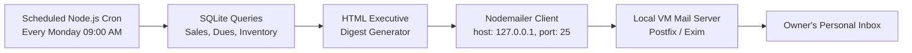
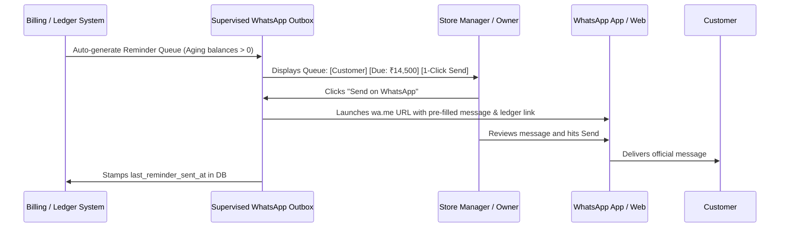

# Automated Financial Email Summaries & Supervised WhatsApp Reminders Specification

> **Status**: Planned / Architectural Specification  
> **Target Release**: Future Implementation  
> **Cost Profile**: ₹0 / $0 (100% Free, zero Meta API fees, self-hosted on existing infrastructure)  
> **Author**: Antigravity AI & System Owner  

---

## 1. Executive Summary

This specification outlines the technical design and operational workflow for two cost-free communication channels in the MacOS Business Suite:

1. **Automated Personal Email Summaries**: Utilizing the existing local SMTP mail server (e.g. Postfix/Exim) running on the same Linux VM (`127.0.0.1:25`), delivering weekly executive financial digests directly to the business owner without third-party email gateway subscriptions.
2. **Supervised WhatsApp Customer Reminders**: Providing automated queue generation and human-supervised dispatching for customer outstanding balances and digital ledger links without Meta WhatsApp Cloud API fees and with zero risk of phone number bans.

---

## 2. Part 1: Automated Personal Email Summaries

### 2.1 Architectural Context
- The production/Oracle VM already runs an internal mail transport agent (MTA) listening on localhost port `25` (or `587`).
- Local loopback delivery (`127.0.0.1:25`) requires **zero SMTP authentication credentials** and does not incur any per-email charges.

### 2.2 System Architecture


### 2.3 Data Aggregated in Weekly Digest
Every week (e.g., Monday at 09:00 AM IST), the cron job queries the central SQLite database:
1. **Sales & Cash Flow (Past 7 Days)**:
   - Total Gross Invoiced (`invoices` table sum)
   - Total Payments Collected (`payments` where `type = 'PAYMENT'`)
   - Total Credits Issued (`payments` where `type = 'CREDIT_NOTE'`)
2. **Aging Customer Receivables**:
   - Total Outstanding Across All Active Customers
   - Top 5 Highest Outstanding Customers
   - Overdue Invoices Aging > 30 Days and > 60 Days
3. **Inventory & Manufacturing Stock Health**:
   - Low-stock finished goods (`products` where `stock < reorder_level`)
   - Low-stock raw materials & packaging items (`raw_materials` / packaging inventory)
4. **Worker Activity Metrics**:
   - Invoices and payments logged by worker roles during the past week

### 2.4 Technical Implementation Plan
- **Library**: `nodemailer`
- **Configuration**:
  ```javascript
  const transporter = nodemailer.createTransport({
    host: '127.0.0.1',
    port: 25,
    secure: false,
    tls: { rejectUnauthorized: false }
  });
  ```
- **Service Location**: `backend/departments/billing/services/email-summary-scheduler.js`
- **HTML Template**: Glassmorphic, modern responsive email template matching the macOS UI aesthetic with clear KPI badges.

---

## 3. Part 2: Automated & Supervised WhatsApp Reminders

### 3.1 The Constraints
- **Meta WhatsApp Cloud API**: Incurs per-conversation billing (~₹0.40 to ₹0.80 per 24-hr session), template verification delays, and complex webhook setups.
- **Unsupervised Headless Bots**: Risk immediate permanent phone number bans by WhatsApp spam detection heuristics.
- **Customer Reality**: Customers rarely open transactional emails but check WhatsApp continuously.

### 3.2 Chosen Approaches

#### Approach A: Supervised WhatsApp Outbox & 1-Click Dispatcher (Recommended & Safest)
*Zero server overhead, 0% ban risk, uses official WhatsApp Web / Desktop / Android application.*



1. **Automated Queue Generation**:
   - Weekly or on-demand, the system scans contacts with `current_due > 0` (excluding contacts marked `exclude_from_stats`).
   - Generates personalized message drafts with dynamic ledger access tokens:
     ```
     Dear {Customer Name},

     Greetings from Utkal Chemical.
     This is a gentle reminder that your current outstanding ledger balance as of {Date} is ₹{Current Due}.

     📄 You can view your complete itemized ledger and invoices here:
     https://mac.faizal.uk/ledger/{Customer Ledger Token}

     For any queries, please reach out to us.
     Thank you for your valued business!
     ```
2. **Supervisor Dashboard**:
   - Embedded directly in Billing &rarr; Ledger or a dedicated "Reminders" tab.
   - Table view showing:
     - Customer Name & Phone Number
     - Outstanding Balance
     - Last Payment Date & Days Overdue
     - Last Reminder Sent (e.g., "5 days ago", "Never")
     - Preview Message Modal
     - Action: `[💬 Send on WhatsApp]` button
3. **1-Click Dispatch Mechanism**:
   - Clicking `[💬 Send on WhatsApp]` uses the standard URI protocol:
     ```javascript
     const cleanPhone = phone.replace(/[^0-9]/g, '');
     const intlPhone = cleanPhone.startsWith('91') ? cleanPhone : `91${cleanPhone}`;
     const url = `https://wa.me/${intlPhone}?text=${encodeURIComponent(personalizedMessage)}`;
     window.open(url, '_blank');
     ```
   - Opens the official WhatsApp Web or WhatsApp Desktop / Android app with the recipient and full text pre-populated.
   - The user presses Enter / Send in WhatsApp.
4. **Audit & Anti-Spam Logging**:
   - The system immediately updates `contacts.last_reminder_sent_at = datetime('now')` and logs an entry in `activity_log`.
   - Prevents sending duplicate reminders to the same customer within a configurable cooldown period (e.g., 7 days).

---

#### Approach B: Self-Hosted Headless WhatsApp Web Gateway with Batch Approval
*For semi-automated bulk dispatching from the VM without opening individual browser tabs.*

1. **How It Works**:
   - A lightweight background Node.js service using open-source libraries (`baileys` or `whatsapp-web.js`) runs on the VM.
   - The user links their official business WhatsApp once by scanning a QR code inside macOS Suite Settings.
   - The backend prepares the weekly reminder batch in a "Pending Approvals" tray.
   - The user reviews the batch in the UI and clicks **"Approve & Dispatch Batch"**.
   - The VM service automatically delivers each message with **randomized human throttling** (8–15 seconds delay between each customer) to safeguard against WhatsApp rate-limiting flags.
2. **Tradeoffs**:
   - Completely free, but requires managing headless Chromium / WhatsApp Web session tokens on the VM.

---

## 4. Feature & Strategy Comparison

| Feature / Criteria | Option A: Supervised 1-Click Dispatcher | Option B: Self-Hosted Headless Gateway | Meta Cloud API |
| :--- | :--- | :--- | :--- |
| **Cost** | **₹0 Free Forever** | **₹0 Free Forever** | Paid per message (~₹0.50–₹0.80) |
| **Human Supervision** | 100% (Pre-filled 1-click review) | Batch Approval in UI | None (Unattended) |
| **Ban Risk** | **0% (Official WhatsApp Client)** | Low (safe with 10s throttling) | 0% (Official API) |
| **Setup Complexity** | Very Low (Pure frontend + DB timestamp) | Moderate (Headless session on VM) | High (Facebook Business Manager) |
| **Works on Mobile / Desktop** | Yes (both WhatsApp Mobile & Web) | Backend VM only | Server API only |
| **Interactive Ledger Link** | Yes (token-based 1-click link) | Yes (token-based 1-click link) | Yes |

---

## 5. Implementation Roadmap (When Ready)

### Phase 1: Local Email Summary Service
- [ ] Add `nodemailer` to backend dependencies.
- [ ] Implement `backend/departments/billing/services/email-summary-scheduler.js`.
- [ ] Add configuration in Settings app for recipient email address and weekly schedule time.
- [ ] Test loopback delivery to `127.0.0.1:25`.

### Phase 2: Supervised WhatsApp Outbox UI (Option A)
- [ ] Add `last_reminder_sent_at` column to `contacts` table schema.
- [ ] Create "Reminders & Outbox" tab in Billing / Ledger view.
- [ ] Implement message template customizer in Billing Settings.
- [ ] Add 1-click `wa.me` dispatcher with dynamic customer ledger links.
- [ ] Add cooldown badge (e.g. "Sent 2 days ago — Cooldown active").

### Phase 3: Optional Headless Gateway (Option B - If Desired Later)
- [ ] Evaluate headless session persistence if volume exceeds 50+ manual dispatches per week.
