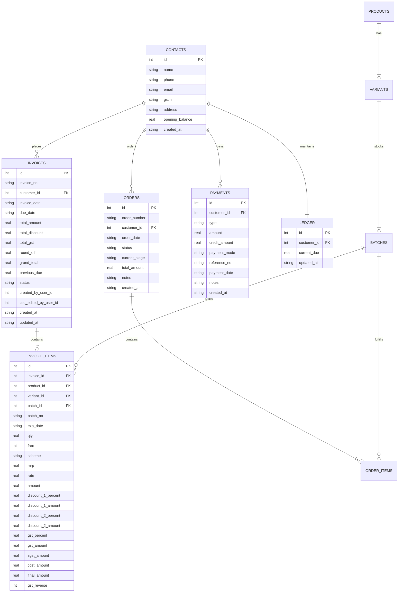

# Comprehensive Billing Architecture, Technology Stack & Components Specification

> **Document Version**: 2.0  
> **Updated**: 2026-09-19  
> **Status**: Production Reference & Architectural Map  
> **Scope**: macOS Business Suite — Billing & Financial Management Module  

---

## 1. Executive Architectural Overview

The Billing module follows an **Authoritative Hybrid Architecture**:
1. **Server-Authoritative Persistence & Settlement**: All database mutations (`POST`, `PUT`, `DELETE`), running customer balances, FIFO debt allocation, invoice sequence numbers, and ledger reconciliations are executed on the Node.js backend.
2. **Zero-Latency Client-Side Calculation Engine (0ms)**: Both the Web Client and the Android Native Client run synchronized, identical calculation engines in local memory. Operators experience instantaneous, non-debounced UI calculations (line item amounts, tiered discounts, reverse GST deduction, scheme bonus free items, tax splits, and round-offs) as they type.
3. **Stateless vs. Stateful Authentication Separation**:
   - **Web Client**: Session cookie authentication (`auth_session`) guarded with CSRF tokens (`csrf_token`).
   - **Android Native Client**: Stateless JWT/Bearer token authentication (`Authorization: Bearer <token>`) with custom platform headers (`X-App-Type: native_android`, `X-Client-Platform: android`) explicitly exempted from browser CSRF challenges.

```
┌──────────────────────────────────────────────────────────────────────────────────┐
│                             HYBRID BILLING TOPOLOGY                              │
└──────────────────────────────────────────────────────────────────────────────────┘

       ┌────────────────────────┐              ┌────────────────────────┐
       │     WEB CLIENT         │              │     ANDROID APP        │
       │  (Vanilla JS / CSS)    │              │ (Kotlin / Jetpack)     │
       │                        │              │                        │
       │  bill-calculator.js    │              │  BillCalculator.kt     │
       │  (Instant 0ms Math)    │              │  (Instant 0ms Math)    │
       └───────────┬────────────┘              └───────────┬────────────┘
                   │                                       │
     Cookie + CSRF │                                       │ Bearer Token
     HTTP Requests │                                       │ (CSRF Exempt)
                   │                                       │
                   ▼                                       ▼
       ┌────────────────────────────────────────────────────────────────┐
       │                     NODE.JS / EXPRESS BACKEND                  │
       │                                                                │
       │  • macos-api-server.js   (Routing, Security, Auth, CSRF Guard) │
       │  • calculator.js         (Authoritative Domain & FIFO Engine)  │
       │  • handlers.js           (API Endpoints & Controllers)         │
       │  • bill-number-gen.js    (Atomic Sequence Allocation)          │
       └───────────────────────────────┬────────────────────────────────┘
                                       │
                                       │ SQL Transactions
                                       ▼
       ┌────────────────────────────────────────────────────────────────┐
       │                     BETTER-SQLITE3 DATABASE                    │
       │                                                                │
       │  invoices • invoice_items • orders • order_items • payments    │
       │  contacts • ledger • products • variants • batches             │
       └────────────────────────────────────────────────────────────────┘
```

---

## 2. Technology Stack & Language Matrix

| Tier | Primary Language | Framework / Tooling | Key Dependencies | Primary Directory |
| :--- | :--- | :--- | :--- | :--- |
| **Backend / Server** | **JavaScript (Node.js)** / CommonJS | Express.js, Better-SQLite3 | `better-sqlite3`, `cookie-parser`, `cors`, `dotenv`, `crypto` | `backend/core/billing/`, `frontend/modules/billing/api/` |
| **Web Client** | **JavaScript (ES6+)**, **HTML5**, **Vanilla CSS** | Native DOM, Custom Window Manager | FontAwesome icons, native Fetch API, Canvas/SVG charts | `frontend/modules/billing/`, `frontend/shared/` |
| **Android Client** | **Kotlin 2.0+** | Jetpack Compose, Material 3, AndroidX | Retrofit 2, OkHttp 3, Coroutines, StateFlow, Gson, Compose Navigation | `android/app/src/main/java/com/example/macosbusinesssuite/` |

---

## 3. Database Schema & Core Entities

All three tiers share an identical entity model stored in SQLite:



---

## 4. Exhaustive Component, Page, Sub-Page & Modal Specification

Below is the complete breakdown of every user-facing tab, screen, modal, and sub-modal across the three tiers.

```
BILLING APP
├── 1. Dashboard Tab / Screen
│   ├── KPI Metrics Cards
│   ├── Receivables Aging Buckets
│   ├── Quick Action Buttons
│   └── Overdue Invoices Reminder List
│
├── 2. New Bill Tab / Screen
│   ├── Customer Selection (Picker Modal)
│   ├── Product Line Items Table
│   │   └── Add Product Dialog (Sub-Modal with Live Preview)
│   ├── Scheme & Bonus Calculation
│   ├── Tax & Discount Summary
│   └── Save / Print Confirmation Dialog
│
├── 3. New Order Tab / Screen
│   ├── Pipeline Stage Selector (Intake, QC/Pack, Dispatch)
│   ├── Customer Picker Modal
│   ├── Order Items List
│   └── Save Order
│
├── 4. Records Management / Edit Center Tab / Screen
│   ├── Invoices Sub-Tab
│   │   ├── Edit Invoice Line Items Modal
│   │   └── Delete Invoice Confirmation Dialog
│   ├── Orders Sub-Tab
│   │   ├── Convert Order to Invoice Modal
│   │   └── Delete Order Confirmation Dialog
│   └── Payments Sub-Tab
│       ├── Edit Payment Modal
│       └── Delete Payment Confirmation Dialog
│
├── 5. Customer Ledger Tab / Screen
│   ├── Customer Dues Directory
│   └── Search / Filter by Outstanding
│
├── 6. Detailed Ledger Statement Tab / Screen
│   ├── Chronological Transaction Table (Debit / Credit / Balance)
│   ├── Statement Date Range Filter
│   └── Export / Print Statement (PDF & CSV)
│
├── 7. Payments & Credit Notes Tab / Screen
│   ├── Payment Entry Form
│   ├── Credit Note Entry Form
│   └── Unpaid Bills Allocation Table
│
└── 8. Billing History Tab / Screen
    ├── Chronological Invoices Register
    └── Duplicate / Reprint Bill
```

---

### Component 1: Billing Dashboard

| Attribute | Web Client Side | Android Native Side | Backend / Server Side |
| :--- | :--- | :--- | :--- |
| **Files** | `frontend/modules/billing/js/dashboard.js`<br>`frontend/modules/billing/css/billing.css` | `ui/screens/billing/BillingDashboardScreen.kt`<br>`domain/calculation/DashboardCalculator.kt` | `backend/core/billing/calculator.js`<br>`frontend/modules/billing/api/handlers.js` |
| **Languages** | Vanilla JavaScript, HTML5, CSS3 | Kotlin, Jetpack Compose | JavaScript (Node.js), Better-SQLite3 |
| **Route / Endpoint** | Tab: `#billing-dashboard-view` | Route: `"dashboard"` | `GET /api/billing/dashboard-metrics` |

#### What It Does & How It Works:
- **KPI Metrics Cards**: Displays Total Billed (₹), Total Collected (₹), Amount Due / Outstanding (₹), Overdue Amount (₹), and Collection Rate (%).
- **Receivables Aging**: Breaks unpaid debt into standard aging buckets: `0-30 Days`, `31-60 Days`, and `61+ Days` with dynamic bar visualization.
- **Date Presets**: Supports filtering by `This Month`, `Last Month`, `This Quarter`, `This Year`, and `All Time`.
- **Overdue Reminders**: Lists customer invoices past their due dates with remaining unpaid balances calculated via FIFO settlement.
- **Data Flow**:
  1. Web and Android trigger `GET /api/billing/dashboard-metrics?preset=...`.
  2. The server (`calculator.js:calculateDashboardMetrics`) executes FIFO debt settlement across all invoices, payments, and opening balances to authoritatively determine remaining debt per invoice.
  3. Returns pre-computed KPIs and aging buckets. Android also caches values in `BillingViewModel.dashboardMetrics` StateFlow.

---

### Component 2: New Bill (Invoice Creation)

| Attribute | Web Client Side | Android Native Side | Backend / Server Side |
| :--- | :--- | :--- | :--- |
| **Files** | `frontend/modules/billing/js/new-bill.js`<br>`frontend/shared/bill-calculator.js` | `ui/screens/billing/NewBillScreen.kt`<br>`domain/calculation/BillCalculator.kt` | `backend/core/billing/calculator.js`<br>`backend/core/billing/bill-number-generator.js`<br>`frontend/modules/billing/api/handlers.js` |
| **Languages** | Vanilla JavaScript, HTML5, CSS3 | Kotlin, Jetpack Compose | JavaScript (Node.js), Better-SQLite3 |
| **Route / Endpoint** | Tab: `#new-bill-view` | Route: `"new_bill"` | `POST /api/billing/calculate`<br>`POST /api/billing` |

#### What It Does & How It Works:
- **Customer Selection**: Operator picks an existing contact or enters a walk-in name. Opening balances and previous debt are immediately badged.
- **Line Items Management**:
  - Products added via autocomplete or barcode.
  - Rate, quantity, Discount 1 (%), Discount 2 (%), GST (%), Scheme (e.g. `5+1`), and Reverse GST flag.
- **Live Non-Debounced Calculations (0ms)**:
  - Both `bill-calculator.js` (Web) and `BillCalculator.kt` (Android) compute line amounts, taxes, discounts, and round-offs locally in real time.
- **Background Server Verification**:
  - Debounced background request (`POST /api/billing/calculate`) validates customer previous debt against ledger history and returns projected balance.
- **Authoritative Persistence (`POST /api/billing`)**:
  - Server re-verifies all arithmetic through `calculator.calculateBillItemsAndSummary`.
  - Atomically allocates sequential invoice number (`GST-YYMM` or `NGST-YYMM`).
  - Writes invoice and line items inside a SQLite transaction.
  - Automatically updates the customer's ledger balance (`current_due`).

---

### Component 3: New Order & Pipeline Management

| Attribute | Web Client Side | Android Native Side | Backend / Server Side |
| :--- | :--- | :--- | :--- |
| **Files** | `frontend/modules/billing/js/new-order.js` | `ui/screens/billing/NewOrderScreen.kt`<br>`domain/calculation/BillCalculator.kt` | `frontend/modules/billing/api/handlers.js` |
| **Languages** | Vanilla JavaScript, HTML5, CSS3 | Kotlin, Jetpack Compose | JavaScript (Node.js), Better-SQLite3 |
| **Route / Endpoint** | Tab: `#new-order-view` | Route: `"new_order"` | `POST /api/billing/orders`<br>`GET /api/billing/orders/next-number` |

#### What It Does & How It Works:
- **Order Pipeline Stages**: Orders are categorized into `Intake (Stage 1)`, `QC / Packing (Stage 2)`, `Dispatch (Stage 3)`, and `Completed`.
- **Order Items**: Line items with product selection, quantities, and rates.
- **Instant Client Calculation**: Previews order totals and taxes immediately using `BillCalculator`.
- **Persistence**: Persisted to `orders` and `order_items` tables with initial status `Pending` or `In Progress`.
- **Conversion Readiness**: Orders in `Dispatch` or `Intake` can be atomically converted into tax invoices without re-typing line items.

---

### Component 4: Records Management & Edit Center

| Attribute | Web Client Side | Android Native Side | Backend / Server Side |
| :--- | :--- | :--- | :--- |
| **Files** | `frontend/modules/billing/js/edit-bills-payments.js` | `ui/screens/billing/EditBillingScreen.kt`<br>`domain/calculation/BillCalculator.kt` | `frontend/modules/billing/api/handlers.js`<br>`backend/core/billing/calculator.js` |
| **Languages** | Vanilla JavaScript, HTML5, CSS3 | Kotlin, Jetpack Compose | JavaScript (Node.js), Better-SQLite3 |
| **Route / Endpoint** | Tab: `#edit-records-view` | Route: `"edit_billing"` | `PUT /api/billing/:id`<br>`DELETE /api/billing/:id`<br>`POST /api/billing/orders/:id/convert-to-invoice`<br>`PUT /api/billing/payments/:id`<br>`DELETE /api/billing/payments/:id` |

#### Sub-Tabs & Functionality:

#### 4A. Invoices Tab:
- **Search & Filter**: Search by invoice number, reference, or customer name.
- **Line-Item Editing Modal**:
  - Allows editing Bill Date, Due Date, and modifying line items.
  - Allows deleting existing items and adding new items from the product catalog.
  - Updates subtotals, GST, and grand total in real-time via `BillCalculator.calculate()`.
  - On "Save Changes", submits `PUT /api/billing/:id` with updated `products` array.
  - Backend deletes old `invoice_items`, writes new calculated items, updates the invoice, and recalculates the customer's ledger balance.
- **Delete Invoice Modal**: Permanently removes invoice and line items; automatically updates the customer's `current_due` in `ledger`.

#### 4B. Orders Tab:
- **Order Status & Actions**: View orders and current pipeline stage.
- **Order-to-Invoice Conversion Modal**:
  - One-click authoritative conversion calling `POST /api/billing/orders/:id/convert-to-invoice`.
  - Server marks order `completed`, creates invoice and line items, updates customer ledger, and allocates invoice number.
- **Delete Order Modal**: Calls `DELETE /api/billing/orders/:id`.

#### 4C. Payments Tab:
- **List Payments**: View all payment vouchers and credit notes.
- **Edit Payment Modal**: Adjust reference number, payment amount, or date; server recalculates customer ledger.
- **Delete Payment Modal**: Removes payment and recalculates customer ledger `current_due`.

---

### Component 5: Customer Ledger Overview

| Attribute | Web Client Side | Android Native Side | Backend / Server Side |
| :--- | :--- | :--- | :--- |
| **Files** | `frontend/modules/billing/js/customer-ledger.js` | `ui/screens/billing/CustomerLedgerScreen.kt` | `frontend/modules/billing/api/handlers.js` |
| **Languages** | Vanilla JavaScript, HTML5, CSS3 | Kotlin, Jetpack Compose | JavaScript (Node.js), Better-SQLite3 |
| **Route / Endpoint** | Tab: `#customer-ledger-view` | Route: `"ledger"` | `GET /api/billing/ledger/customers` |

#### What It Does & How It Works:
- **Customer Directory**: Displays list of all customer accounts with opening balance, total debits (invoices), total credits (payments/credit notes), and net balance (`current_due`).
- **Color-Coded Badging**: Red badge for overdue/debit balance (receivable), Green badge for advance/credit balance.
- **Search**: Search across names, phone numbers, and GSTINs.
- **Navigation**: Tapping a customer transitions directly to their **Detailed Ledger Statement**.

---

### Component 6: Detailed Customer Statement & History

| Attribute | Web Client Side | Android Native Side | Backend / Server Side |
| :--- | :--- | :--- | :--- |
| **Files** | `frontend/modules/billing/js/ledger.js`<br>`frontend/modules/billing/js/ledger-file-utils.js` | `ui/screens/billing/DetailedLedgerScreen.kt`<br>`domain/calculation/FifoSettlementCalculator.kt` | `backend/core/billing/calculator.js`<br>`frontend/modules/billing/api/handlers.js` |
| **Languages** | Vanilla JavaScript, HTML5, CSS3 | Kotlin, Jetpack Compose | JavaScript (Node.js), Better-SQLite3 |
| **Route / Endpoint** | View: Customer Statement Sheet | Route: `"detailed_ledger/{customerId}"` | `GET /api/billing/customers/:id/statement`<br>`GET /api/billing/public/ledger/:id` |

#### What It Does & How It Works:
- **Chronological Transaction Ledger**: Combines opening balance, invoices (debits), and payments/credit notes (credits) into a sequential running balance ledger.
- **Strictly Prior Sequence Resolution**: Guarantees that running balances match financial statements down to the exact millisecond and ID sequence.
- **Statement Header**: Customer address, phone, GSTIN, and company bank details.
- **Export & Print**:
  - Web: Renders printable statement sheet and exports to PDF / CSV.
  - Android: Native print / share sheet generation.

---

### Component 7: Payments & Credit Notes

| Attribute | Web Client Side | Android Native Side | Backend / Server Side |
| :--- | :--- | :--- | :--- |
| **Files** | `frontend/modules/billing/js/payment-credit-note.js` | `ui/screens/billing/PaymentsCreditNoteScreen.kt` | `frontend/modules/billing/api/handlers.js`<br>`backend/core/billing/calculator.js` |
| **Languages** | Vanilla JavaScript, HTML5, CSS3 | Kotlin, Jetpack Compose | JavaScript (Node.js), Better-SQLite3 |
| **Route / Endpoint** | Tab: `#payments-credits-view` | Route: `"payments"` / `"payments/{type}"` | `GET /api/billing/payments`<br>`POST /api/billing/payments`<br>`GET /api/billing/customers/:id/outstanding` |

#### What It Does & How It Works:
- **Mode Toggle**: Easily toggle between `Payment` (customer paying us) and `Credit Note` (sales return / price adjustment).
- **Customer Selection & Outstanding Due**: Selecting a customer immediately queries `GET /api/billing/customers/:id/outstanding` to show unpaid invoices.
- **Bill Allocation (FIFO)**: Displays unpaid bills; payments can be auto-allocated to oldest bills or entered as lump sum.
- **Payment Method**: Cash, Cheque, UPI, Bank Transfer, NEFT/RTGS.
- **Ledger Sync**: Submitting the record automatically adjusts customer `current_due` in `ledger` and updates statement running balance.

---

### Component 8: Billing History & Invoices Register

| Attribute | Web Client Side | Android Native Side | Backend / Server Side |
| :--- | :--- | :--- | :--- |
| **Files** | `frontend/modules/billing/js/history.js` | `ui/screens/billing/BillingHistoryScreen.kt` | `frontend/modules/billing/api/handlers.js` |
| **Languages** | Vanilla JavaScript, HTML5, CSS3 | Kotlin, Jetpack Compose | JavaScript (Node.js), Better-SQLite3 |
| **Route / Endpoint** | Tab: `#billing-history-view` | Route: `"history"` | `GET /api/billing?limit=...&offset=...` |

#### What It Does & How It Works:
- **Audit Register**: Full searchable history of all generated invoices with creation timestamp, creator user role, and editor user role.
- **Reprint / Duplicate**: Re-opens bill preview for thermal or duplex printing.
- **Status Filter**: Filter by Paid, Partial, or Completed.

---

## 5. Modals & Sub-Modals Catalog

| Modal / Dialog Name | Parent Screen(s) | Trigger / Action | Functionality & Form Fields |
| :--- | :--- | :--- | :--- |
| **Customer Picker Modal** | `NewBillScreen`, `NewOrderScreen`, `PaymentsCreditNoteScreen` | "Pick Customer" / Search field | Searchable contact directory with phone number and current balance badges. Selecting a contact populates customer ID, name, phone, and opening balance. |
| **Add Product Dialog** | `NewBillScreen`, `NewOrderScreen`, `EditBillingScreen` | "+ Add Item" FAB / Button | Product name autocomplete, Rate/MRP, Quantity, Disc 1 (%), Disc 2 (%), GST (%), Scheme (`5+1`), Reverse GST checkbox. **Features Live Synchronous Calculation Preview Banner** showing line total, tax, and bonus items in real time. |
| **Edit Bill Dialog** | `EditBillingScreen` | Edit icon on Invoice item | Full line-item management sheet: displays existing line items with rates, quantities, taxes, and final totals. Allows deleting items, adding new items via `AddProductDialog`, editing Bill Date and Due Date. Live recalculation via `BillCalculator`. |
| **Convert Order to Invoice Dialog** | `EditBillingScreen` | Checkmark icon on Order item | Confirmation modal: Converts order into an authoritative tax invoice, assigns sequential invoice number (`GST-YYMM`/`NGST-YYMM`), deducts batch stock, and posts to customer ledger. |
| **Edit Payment Dialog** | `EditBillingScreen` | Edit icon on Payment item | Edits payment reference number, amount, or payment date. Recalculates customer ledger balance upon save. |
| **Delete Confirmation Dialog** | `EditBillingScreen` | Trash icon on Bill, Order, or Payment | Prevents accidental data deletion. Deleting an invoice or payment recomputes customer ledger balance and updates SQLite ledger. |
| **Print / Preview Modal** | `NewBillScreen`, `BillingHistoryScreen` | Save & Print / Duplicate | Generates formatted GST tax invoice layout supporting thermal 80mm receipts and duplex A4 print sheets. |

---

## 6. Calculation Parity Rules & Mathematical Formulas

All three sides (`calculator.js`, `bill-calculator.js`, and `BillCalculator.kt`) execute the exact same mathematical sequence:

### 1. Reverse GST Deduction (Embedded Tax Extraction)
When `gst_reverse` is enabled on an MRP item (e.g. Ayurvedic/Herbal tonics with MRP inclusive of 5% GST):
$$\text{Base Rate} = \text{MRP} \times (1 - 0.0477) = \text{MRP} \times 0.9523$$
*(4.77% represents the embedded tax fraction: $5\% \div (1 + 5\%) \approx 0.047619$)*

### 2. Multi-Tier Cascading Discounts
$$\text{Base Amount} = \text{Rate} \times \text{Qty}$$
$$\text{Discount}_1 = \text{Base Amount} \times \left(\frac{\text{Disc}_1\%}{100}\right)$$
$$\text{Amount After Disc}_1 = \text{Base Amount} - \text{Discount}_1$$
$$\text{Discounted Rate} = \text{Rate} \times \left(1 - \frac{\text{Disc}_1\%}{100}\right)$$
$$\text{Discount}_2 = \text{Amount After Disc}_1 \times \left(\frac{\text{Disc}_2\%}{100}\right)$$
$$\text{Taxable Base} = \text{Amount After Disc}_1 - \text{Discount}_2$$

### 3. GST & Tax Split
$$\text{Total GST Amount} = \text{Taxable Base} \times \left(\frac{\text{GST}\%}{100}\right)$$
$$\text{SGST Amount} = \text{Taxable Base} \times \left(\frac{\text{SGST}\%}{100}\right) = \frac{\text{Total GST Amount}}{2}$$
$$\text{CGST Amount} = \text{Taxable Base} \times \left(\frac{\text{CGST}\%}{100}\right) = \frac{\text{Total GST Amount}}{2}$$
$$\text{Final Line Amount} = \text{Taxable Base} + \text{Total GST Amount}$$

### 4. Scheme Bonus Free Items Calculation
For scheme format $X+Y$ (e.g., `"5+1"` where buying 5 earns 1 free item):
$$\text{Complete Sets} = \left\lfloor \frac{\text{Qty}}{X} \right\rfloor$$
$$\text{Free Bonus Quantity} = \text{Complete Sets} \times Y$$
*(Free items are recorded in inventory without increasing the bill's taxable base).*

### 5. Summary & Round-Off Arithmetic
$$\text{Subtotal} = \sum \text{Base Amount} - \sum \text{Discounts} + \sum \text{GST}$$
$$\text{Grand Total} = \text{round}(\text{Subtotal})$$
$$\text{Round Off} = \text{Grand Total} - \text{Subtotal}$$

---

## 7. Security, Origin & Network Layer

| Aspect | Web Implementation | Android Implementation | Server Enforcement |
| :--- | :--- | :--- | :--- |
| **Authentication** | Cookie-based session (`auth_session`). | HTTP Header: `Authorization: Bearer <token>`. | Validates cookie or token via `authMiddleware` in `macos-api-server.js`. |
| **CSRF Protection** | Validates `X-CSRF-Token` header matching cookie secret on mutating calls (`POST`, `PUT`, `DELETE`). | Exempt: Requests containing Bearer token or `X-App-Type: native_android` bypass web CSRF checks. | Enforced in `csrfMiddleware` in `macos-api-server.js`. |
| **CORS / Origin** | Same-origin or internal desktop origin. | OkHttp native connection (`Origin: null` or Android package identity). | Whitelisted in CORS headers. |
| **Data Serialization** | Native JSON with lenient dynamic typing. | Strongly-typed Kotlin Data Classes via Retrofit + Gson. | Structured JSON with unified error payloads `{ error: string, message?: string }`. |

---

## 8. Verification & Parity Test Scripts

The integrity of all three sides is verified via automated test scripts in the codebase:

1. **Server-Side Processing & Formula Suite**:
   ```bash
   node backend/scripts/test-billing-server-processing.js
   ```
   *Tests: Reverse GST, tiered discounts, scheme free items, round-off, customer statement previous due, authoritative bill creation, order-to-invoice atomic conversion.*

2. **4 Core Apps Parity Verification**:
   ```bash
   node backend/scripts/verify-4-core-apps-parity.js
   ```
   *Tests: Billing `amountDue` == Analytics `total_receivables` ($₹23,954$), Billing `totalBilled` == Analytics `total_billed` ($₹36,774$), Contacts directory count, and Product catalog schemas.*

3. **Android Client Calculator Unit Test Suite**:
   ```bash
   cd android && .\gradlew.bat testDebugUnitTest --tests com.example.macosbusinesssuite.BillCalculatorTest
   ```
   *Tests: Android `BillCalculator.kt` mathematical parity against backend `calculator.js`.*

4. **Android Compilation & Build Test**:
   ```bash
   cd android && .\gradlew.bat compileDebugKotlin
   ```
   *Validates: Zero syntax, type, or reference errors across all Kotlin Compose screens and ViewModels.*

---

## 9. Architectural Parity Summary

| Metric / Feature | Backend / Server | Web Client | Android Client | Status |
| :--- | :---: | :---: | :---: | :---: |
| **Line Item Calculation** | Authoritative (`calculator.js`) | Instant (`bill-calculator.js`) | Instant (`BillCalculator.kt`) | **100% Match** |
| **Reverse GST (-4.77%)** | Supported | Supported | Supported | **100% Match** |
| **Tiered Cascading Discounts** | Supported | Supported | Supported | **100% Match** |
| **Scheme Free Items** | Supported | Supported | Supported | **100% Match** |
| **Customer Ledger Reconciliation** | Atomic DB update | Reactive statement view | Reactive statement view | **100% Match** |
| **FIFO Debt Allocation** | Centralized in DB | Server pre-computed | Server pre-computed + local | **100% Match** |
| **Order-to-Invoice Conversion** | Atomic transaction | One-click button | One-click dialog | **100% Match** |
| **Bill Line-Item Editing** | `PUT /api/billing/:id` | Full line-item editor | Full line-item editor | **100% Match** |
